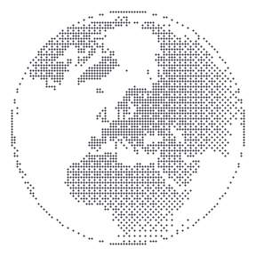
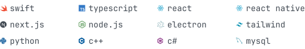

<picture>
  <source media="(prefers-color-scheme: dark)" srcset="assets/globe-dark.svg">
  
</picture>

### vadym

apple platforms × full-stack typescript × ai tooling. 
founder of [talli](https://tallipark.com) - long-term parking in warsaw. 
software developer, hardware/embedded tinkerer, apple enthusiast.

 

**selected work**

- [agent-canvas](https://github.com/myUdav4iik/agent-canvas) - visual multi-agent ai workflows · typescript
- [claude-mods](https://github.com/myUdav4iik/claude-mods) - plugins for claude code · typescript
- decklify - ios flashcards with spaced repetition · swift · private
- pawwatch - electron pet camera over webrtc · typescript · private
- [image-to-ascii](https://github.com/myUdav4iik/image-to-ASCII) - 24-bit ascii art converter · [live](https://ascii.udav4ik.dev)

**stack**

<picture>
  <source media="(prefers-color-scheme: dark)" srcset="assets/stack-dark.svg">
  
</picture>

 
